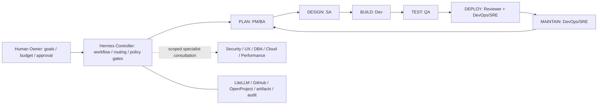

# Hermes AI Software Company — six-stage SDLC orchestration

> **STATUS: Architecture and implementation plans only — NOT deployed or implemented.**  
> **Design baseline: 2026-11-05.** **Owner:** Human Founder / Product Owner.  
> **Target:** Portable, evidence-driven AI software team; local/sandbox 2-day MVP, then AWS ECS Fargate Full architecture.

## Decision

One **Human Founder/Owner** + one **deterministic Hermes Orchestrator** + **six logical core AI roles** + a narrow **on-demand Specialist Pool**. The orchestrator is workflow software, **not an extra reasoning role or approval authority**. Role count is **not** a count of always-on servers.

**Six AI roles:** PM/BA · Solution Architect · Developer · QA/Tester · Independent Reviewer · DevOps/SRE.  
**Six SDLC processes:** **Plan → Design → Build → Test → Deploy → Maintain → Plan** (continuous feedback).

**Key rule:** the AI Independent Reviewer generates risk/quality findings, **not a binding human approval**. Owner, named code owner, policy owner and release manager remain accountable for their designated approval gates. Tests, policies and CI are mandatory external checks, not self-assertions by an agent.

## Two implementation phases

| | Phase 1 — **MVP (hard 2 working days / 16 engineer-hours)** | Phase 2 — **FULL (complete target design)** |
|---|---|---|
| Goal | One bounded, traceable 6-stage demo feature with a real PR/test run | Secure, durable AI-operated SDLC, including closed-loop maintenance |
| Runtime | Local/sandbox single-process sequential controller, reusable role profiles | Hermes Gateway + Fargate worker RunTask, DynamoDB locks/idempotency, S3 artifacts |
| Roles | 6 logical role profiles; one worker implementation; on-demand specialists not required | 6 isolated roles, specialists and governed concurrency |
| Workflow | Markdown/JSON artifact handoffs, manual human gates, QA and independent review | OpenProject integration, stage gates, CI/evals, incident-triggered loops, telemetry |
| Memory | Static instructions, bounded run history, proposed lessons only | Versioned per-role/project snapshots, approved skill promotion, simulations of mood based on measured outcomes |
| Deploy | PR + DEV/demo validation only; **no production deploy** | Per-environment privileges, human-authorized production release and tested rollback |
| Completion proof | Real artifact chain, tests, branch/PR, approval audit and negative gate tests | Security/reliability/incident/learning/portability end-to-end test suite |

**2-day MVP is a timeboxed plan, not a commitment to build everything from the Full architecture in 2 days.** It assumes existing Hermes, LiteLLM and GitHub access; blocked or mocked integrations must be disclosed. The Full architecture can use existing AWS/managed components but should add new services only when justified by measured need.

## Adopted ideas from vtno/skills

[11 — Selective Skills adoption and safety plan](docs/11-vtno-skills-adoption.md) adds **one planned PR per task**, a **separate independent Reviewer**, **Standards versus Spec** review, bounded retry and skill provenance. No new role, service or extra MVP day is required. This design references [vtno/skills](https://github.com/vtno/skills) at a pinned commit; it **does not install or vendor third-party code**.

## Read first — authoritative plans

1. [08 — Six-stage target workflow and role contracts](docs/08-six-stage-role-target.md)
2. [09 — Two-day MVP hour-by-hour execution plan and Definition of Done](docs/09-mvp-two-day-execution.md)
3. [10 — Full implementation roadmap, waves F0–F5 and acceptance](docs/10-full-implementation-roadmap.md)

## Original reference designs (retained as detailed background)

- [01 — Architecture alternatives](docs/01-architecture-options.md)
- [02 — Lean AWS runtime](docs/02-target-architecture.md)
- [03 — Earlier five-role design (superseded by 08)](docs/03-agent-team-design.md)
- [04 — Memory, learning and simulated mood (Full)](docs/04-memory-learning-mood.md)
- [05 — Earlier multi-sprint MVP plan (superseded by 09)](docs/05-mvp-plan.md)
- [06 — Selected references: MetaGPT + Letta ideas without new runtimes](docs/06-reference-project-adoption.md)
- [07 — Operations, cost, security and portability guardrails](docs/07-operational-guardrails.md)

Where older docs refer to **five roles**, combined BA/Tester, the PM/Gateway as a single AI role, or a multi-sprint MVP, **08/09/10 supersede those counts, role assignments and MVP deadline**. Remaining AWS isolation, budget and memory safeguards still inform Full.

## Execution issues (implementation backlog)

- **MVP Day 1:** [#2 — preflight, six role contracts, controller, Plan/Design](https://github.com/adisornsir/coe-eap-hermes-orchestration/issues/2) — 8 hours.
- **MVP Day 2:** [#3 — Build/Test/Review/Deploy prep/Maintain](https://github.com/adisornsir/coe-eap-hermes-orchestration/issues/3) — 8 hours.
- **Full roadmap:** [F0 #4](https://github.com/adisornsir/coe-eap-hermes-orchestration/issues/4) → [F1 #5](https://github.com/adisornsir/coe-eap-hermes-orchestration/issues/5) → [F2 #6](https://github.com/adisornsir/coe-eap-hermes-orchestration/issues/6) → [F3 #7](https://github.com/adisornsir/coe-eap-hermes-orchestration/issues/7) → [F4 #8](https://github.com/adisornsir/coe-eap-hermes-orchestration/issues/8) → [F5 #9](https://github.com/adisornsir/coe-eap-hermes-orchestration/issues/9). Ship required high-impact controls before enabling protected operations regardless of wave order.

**All issues are planned, not implemented.** Work should start after architecture baseline approval and the prerequisite access checks.

## Non-negotiable boundaries

- Owner sets priorities, budget, acceptance and production scope; protected merges and release gates require the *designated human* approver.
- Developer cannot approve own changes; QA cannot silently weaken acceptance tests; AI Reviewer cannot authorize a protected merge.
- Agent profiles, role prompts and skills are **guidance, not security sandboxes**. Use real IAM/tool permissions, secrets isolation, branch protection, and managed approval gates.
- Never run two processes writing the same Hermes home/database; use isolated project/role snapshots and locks in Full.
- No uncontrolled network/production access, no silent self-learning of privileged policies, no standing production secrets.
- Simulated mood is a transparent KPI visualization only, never a safety, budget or approval signal.
- Every stage advances only with recorded artifact evidence; do not claim a feature is done based on agent text.

## Source inspiration

Based on the user-provided *The AI-Native SDLC Playbook* (Anthropic): Plan, Design, Build, Test, Deploy, Maintain; handoffs via versioned intent/spec/plan/code/test/review/incident artifacts and human accountability. Hermes-specific six-role architecture and the phase split are project design decisions, **not** prescriptions made by the playbook.
