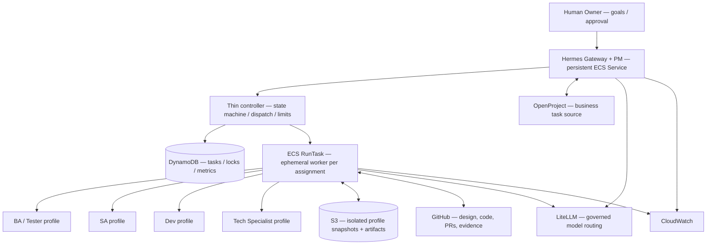

# Hermes AI Software Delivery Team — MVP Architecture

> **Status:** Design baseline / not deployed. **Owner:** Human Product Owner. **Target:** AWS ECS Fargate + Hermes Agent + LiteLLM + OpenProject + GitHub.

สร้าง **1 AI software squad** ที่ทำงานได้จริง โดย Owner เป็นมนุษย์ 1 คน และมี AI 5 roles ได้แก่ **PM, BA/Tester, Solution Architect, Developer, Tech Specialist**. ทุก Agent มี identity, memory, learning history และ *simulated mood* ที่อิงคุณภาพและภาระงาน ไม่ใช่อารมณ์จริง

## Recommended decision

**Option B — Lean Fargate Team**: 1 persistent Hermes Gateway/PM + ephemeral **one task per work item** for other roles; use an intentionally small deterministic controller, DynamoDB task/role locks, S3 snapshots/artifacts and existing LiteLLM / OpenProject / GitHub. **No SQS, Step Functions, vector DB, GPU EC2, custom dashboard, or multi-tenant SaaS in MVP.**

การเริ่มต้นจริงควรทำด้วย **one project, one feature, one active task per role** (multi-project is a later design capability, not a launch promise).

## Read in order

1. [Architecture alternatives and decision](docs/01-architecture-options.md)
2. [Target architecture and runtime boundaries](docs/02-target-architecture.md)
3. [Team workflow, roles and contracts](docs/03-agent-team-design.md)
4. [Memory, learning and simulated mood](docs/04-memory-learning-mood.md)
5. [MVP build plan and definition of done](docs/05-mvp-plan.md)
6. [Reference projects: inspiration vs actual integration](docs/06-reference-project-adoption.md)

## Non-negotiable rules

- Human Owner approves scope and production release; agents do not spend money, merge or deploy production autonomously.
- **Never mount one writable Hermes home/profile into two running agent processes.** One role execution at a time in MVP; use role/project namespace and versioned snapshot.
- `SOUL.md`/prompts are guidance, **not isolation controls**. Enforce least privilege with IAM, GitHub permissions and separate credentials.
- Quality and review are measured from CI, PRs, OpenProject and Owner decisions — **not agent self-report**.
- Mood is a **derived UI expression**; it cannot bypass controls or override planning priority.
- Document contains architecture and examples, **not a production-ready deployment**.

## References

- [Hermes Profiles](https://hermes-agent.nousresearch.com/docs/user-guide/profiles/)
- [Hermes Persistent Memory](https://hermes-agent.nousresearch.com/docs/user-guide/features/memory/)
- [Hermes Skills](https://hermes-agent.nousresearch.com/docs/user-guide/features/skills/)
- [ECS storage options](https://docs.aws.amazon.com/AmazonECS/latest/developerguide/using_data_volumes.html)
