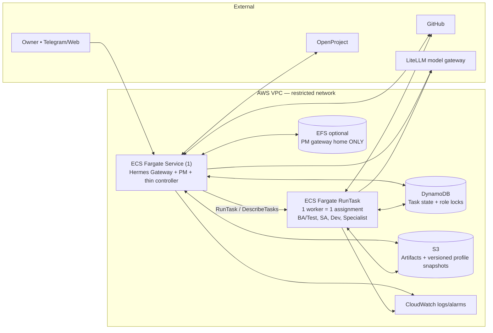

# 02 — Target architecture (lean MVP)

## Logical and AWS deployment diagram



### Components (minimal count)

| Component | Runs how | Responsibilities | MVP notes |
|---|---|---|---|
| Hermes Gateway + PM | 1 ECS Service, persistent | Owner channel, task plan, status, approvals; **single PM profile writer** | EFS access point **only for PM home** if existing image requires local persistence |
| Thin Controller | Same service/process boundary as Gateway | Deterministic workflow; ECS RunTask/DescribeTasks; role lock; timeout/retry; audit events | A custom adapter is necessary; Hermes alone is not a distributed job queue |
| Worker | Standalone Fargate task, exits after assignment | Execute a bounded BA, SA, Dev or Specialist assignment | Generic image + role-specific profile snapshot/permissions |
| DynamoDB | Serverless | Task state, idempotency, `role_lock`, minimal metrics | No relational database or centralized session SQLite |
| S3 | Serverless | Immutable handoff artifacts, snapshot versions, QA evidence | Enable SSE and versioning, restrict prefixes |
| OpenProject | Existing | Epics, Stories, AC, owner status | Source of truth for business work |
| GitHub | Existing | Source, designs, PR and CI evidence | Source of truth for code |
| LiteLLM | Existing | Model aliases, per-role keys, budgets | PM gothink2; BA gothink1; SA gothink2; Dev godev1; Specialist gothink1 (examples only) |
| CloudWatch | Managed | Structured logs, task failures, alarms | Correlation: project_id/task_id/agent_id |

**Not in MVP:** SQS, Step Functions, separate dashboard service, vector DB, GPU EC2, CrewAI/MetaGPT/Letta as additional runtimes, autonomous deployment and multi-tenant isolation.

## Task execution protocol

1. Owner creates goal; PM stores a feature/Story in OpenProject and drafts a stage plan.
2. Controller checks prerequisite stage, permissions, role lock, task budget and idempotency; records `QUEUED` with a unique `task_id`.
3. Controller atomically acquires `ROLE#project_id#role_id` lock in DynamoDB (lease + fencing token), moves task to `RUNNING`, and calls ECS `RunTask` with **IDs and artifact pointers only**, never secrets or full prompts.
4. Worker validates assignment, fetches **its own** profile version and inputs to private ephemeral storage, runs Hermes, writes outputs and structured result with hashes to S3, and records status in DynamoDB. Credentials from Secrets Manager/task role.
5. Controller polls ECS status + DynamoDB results initially (bounded periodic polling). Failures/heartbeat expiry produce `RETRYABLE` or `BLOCKED`; release lease only with matching fencing token.
6. PM verifies artifacts/evidence and advances the workflow; after QA awaits Owner approval. On exit, approved memory/skill snapshot is promoted by the snapshot service/wrapper only if original version matches.

**Important:** Profile snapshots are not shared mounted databases. Each worker gets a distinct isolated local home; **one active writer per role/project**; no concurrent `state.db` writers. On crash, use last committed version, not a partially uploaded database. Per-project memory and credentials must not be mixed.

## Artifact layout (illustrative)

```text
s3://<private-bucket>/
  projects/<project_id>/tasks/<task_id>/input.json
  projects/<project_id>/tasks/<task_id>/result.json
  projects/<project_id>/tasks/<task_id>/evidence/
  agents/<project_id>/<role_id>/snapshots/<version>.tar.gz
  agents/<project_id>/<role_id>/lessons/<task_id>.json
```

Task result includes `task_id, project_id, role_id, status, artifact_uris, evidence_uris, input_version, output_version, started_at, ended_at, usage, error_code`. Do not place confidential inputs/outputs in GitHub; repo should contain architecture/config templates only.

## Reliability / security baseline

- **Role IAM:** PM can dispatch only approved task definitions; Worker can read/write only its allowed S3 prefixes and model gateway; repo permissions differ by role.
- **Network:** private subnets and controlled egress where practical; NAT cost should be explicitly estimated; no public worker ingress.
- **Secrets:** Secrets Manager (or approved secret source), short-lived credentials when possible; no keys committed, no secrets in RunTask environment overrides.
- **Retry:** max 2 attempts before human review, with stable idempotency key. A rerun writes a fresh attempt prefix, never overwrites accepted evidence.
- **Controls:** Owner must approve scope and release. Agents only create branches/PRs, never merge or deploy to production without explicit approval.
- **Metrics:** task success, first-pass acceptance, rework, backlog units, utilization, cost per accepted story, 7-day trend.
- **Cost:** watch the persistent gateway 24/7, Fargate session-hours, NAT egress, LiteLLM tokens and log retention. Set budgets before enabling schedules.

## Hermes-specific validation

Hermes profiles have independent config, SOUL, memory, sessions, skills and state databases; **a profile is NOT a sandbox** and two processes must not write one profile together. See:
- https://hermes-agent.nousresearch.com/docs/user-guide/profiles/
- https://hermes-agent.nousresearch.com/docs/user-guide/features/memory/
- https://docs.aws.amazon.com/AmazonECS/latest/developerguide/using_data_volumes.html
