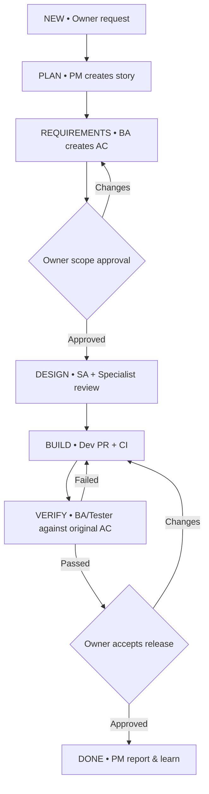

# 03 — AI team design and workflow

## One owner + five AI roles

| Role | Accountable outcome | Inputs | Deliverables | Permission boundary |
|---|---|---|---|---|
| **Human Owner** | Value, priorities, budget, acceptance, production releases | PM proposal and evidence | Approve/reject with reason | Only role with production-release/business approval |
| **PM** (`pm`) | Plan and coordinate | Owner goal, work status | Story breakdown, dependencies, blockers, handoff, final summary | OpenProject write; Git read; no code merge |
| **BA / Tester** (`ba-tester`) | Testable requirements and objective QA | Owner goal, PR, CI | User Stories, AC, test plan, defect report, QA sign-off | OpenProject AC/QA; test environment only |
| **SA** (`sa`) | Coherent technical design | AC, constraints | C4-lite diagram, ADR, API/data contract, review findings | Design changes via PR; no deployment |
| **Dev** (`dev`) | Working code with reproducible tests | Approved AC/design | Branch, PR, unit tests, build result | Scoped repo branch; no direct main merge |
| **Tech Specialist** (`specialist`) | Feasibility, cloud/security/performance | Design, code, environment | Security/IaC review, risk register, recommendations | Infra plan/read; no production apply |

PM is one of the **five agents** (not a sixth controller-agent). The deterministic controller is ordinary software in the PM/Gateway service.

## Lightweight state machine



**MVP serialization:** SA and Specialist may prepare comments concurrently **as different role writers**, but each role is limited to 1 active execution. Project A/B isolation remains a design extension, not enabled at pilot launch.

## Stable communication (not agent-to-agent free chat)

1. Every assignment originates from PM/controller and links an OpenProject work item.
2. Agent receives a bounded immutable task envelope with only necessary artifact pointers.
3. Output must include artifacts **and evidence** before stage advancement; a chat statement 'done' is insufficient.
4. A reviewer must read artifacts and CI output, not trust the Dev's self-reported pass.
5. One free correction attempt, then escalation to PM/Owner with defect summary and budget impact (tune after pilot).

### Example task envelope (illustrative contract, NOT native Hermes or ECS payload)

```json
{
  "task_id": "task-00042",
  "project_id": "pilot",
  "work_item_id": "OP-101",
  "role_id": "dev",
  "stage": "BUILD",
  "attempt": 1,
  "idempotency_key": "pilot:OP-101:BUILD:1",
  "input_uris": ["s3://private-bucket/projects/pilot/tasks/task-00042/input.json"],
  "acceptance_criteria_uri": "s3://private-bucket/projects/pilot/ac/OP-101.md",
  "snapshot_version": "v3",
  "timeout_minutes": 45,
  "spend_limit_usd": 2.00
}
```

### Example task result

```json
{
  "task_id": "task-00042",
  "role_id": "dev",
  "status": "REVIEW",
  "artifact_uris": ["github:owner/repo/pull/123"],
  "evidence_uris": ["s3://private-bucket/projects/pilot/tasks/task-00042/evidence/ci.json"],
  "summary": "API endpoints implemented; CI executed",
  "risks": [],
  "usage": {"cost_usd": 0.72}
}
```

## Role prompts

Each agent profile gets `SOUL.md` with: (1) role, (2) goals and tone, (3) required output format, (4) escalation criteria, (5) forbidden actions, (6) context and evidence rules. Persistent role identity is independent of transient worker container and simulated mood.

## Cross-role sign-off rules

- BA defines criteria **before** Dev implementation; Owner locks scope for MVP.
- SA signs off technical design or highlights trade-offs before Build.
- Tech Specialist checks minimum security/IAM/operability before Build, and reviews risky changes as needed.
- Dev opens PR and CI must finish.
- BA/Tester checks AC via evidence and test execution.
- PM prepares delivery summary (acceptance evidence + cost + residual risks).
- Owner makes final release decision, recorded with timestamp, actor and rationale.

## Pilot Story

'Create a Customer CRUD API with login + role-based authorization' works well as first sample. Success requires runnable code, automated tests, PR, security assessment, traceable AC, full audit and Owner acceptance; no production deployment is required.
