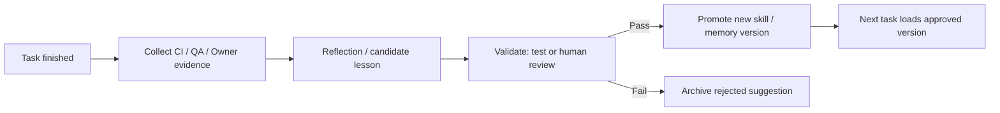

# 04 — Persistent identity, controlled learning, simulated mood

## Principle

## Four logical components (2026-11-10)

**New authoritative separation:** [15 — Durable execution, agent memory and skills](15-logical-boundary-architecture.md). Hermes uses **WorkflowController**, **DurableExecution**, **AgentMemory**, and **SkillManager** as distinct *logical components*. **AgentWorker** consumes approved profile/memory/skill versions and produces execution evidence. These are **not separate microservices by default**.

- **DurableExecution** owns task/attempt state, idempotency, checkpoint/restart and evidence pointers. A completed task is **not** automatically a learned fact.
- **AgentMemory** owns approved role/project-scoped knowledge, candidate lessons and snapshot history.
- **SkillManager** owns reviewed procedures and versioned promotion/rollback; a `SKILL.md` is not a permission grant.
- **WorkflowController** alone evaluates transition and promotion policy, with named human/external approval where required.

A newly approved memory or skill is loaded by the **next task**, not silently injected into an existing retry. Full F1 implements durable execution; F4 implements governed continuous learning. The two-day local MVP remains unchanged.

**One role = one identity, not one always-on server.** Hermes-native managed worker processes are replaceable on a single host. An agent's identity, history and approved skills survive via the host's profile storage and governed versioned backups. Mood is **a calculated operational presentation**, not genuine feelings or model consciousness.

## Memory and learning by source of truth

| Layer | What is kept | Persistence | Promotion rule |
|---|---|---|---|
| Identity | Role name, personality, boundaries and `SOUL.md` | Git version | Owner-approved change |
| Working memory | Current task context/scratch | Ephemeral worker local | Discard after task, archive evidence |
| Personal memory | Compact learnings and conventions | Versioned per-role snapshot in S3 | One writer; controlled snapshot promotion |
| Project memory | Decisions, APIs, AC, context | Git / OpenProject / S3 artifacts | Versioned and project-scoped |
| Procedural skills | Checklists and reusable `SKILL.md` | Role-local + Git review | Stage → test → review → promote |
| Performance | QA results, acceptance, rework, cost | Native Kanban event history plus validated external CI/LiteLLM metrics; DynamoDB optional later | Trusted policy/CI checks normalize outcome evidence |
| Mood state | Status label + metrics + reason | Derived from metrics; optionally cached | Rule-based, cannot grant authority |

Hermes supports persistent `MEMORY.md`, `USER.md`, session search and skill creation. It has bounded prompt memory, and loaded memories are snapshots at session start. **Never treat the memory file as a multi-writer distributed store.**

### Learning loop

Enable Hermes native approval gates for memory and skill writes where supported by chosen release (`memory.write_approval: true`, `skills.write_approval: true`). **Do not equate a staged write with applied learning.** Run a snapshot commit after approval; use a compare-and-swap version and a per-role lease. Make promotion idempotent. Do not self-modify code, policies or privileges.

## Performance and workload model (MVP)

Unit of measurement: **completed assigned work items weighted by estimated effort**, rather than token count. PM estimates effort per task and adjusts from real wall-time; this is a capacity calibration, not human-hours productivity.

- `accepted_first_pass_rate = tasks_accepted_without_rework / reviewed_tasks * 100` (from objective QA + Owner review).
- `on_time_rate = accepted_tasks_on_or_before_due / due_reviewed_tasks * 100`.
- `success_score = 0.70 * accepted_first_pass_rate + 0.30 * on_time_rate`; if denominator is 0, display **insufficient data**, not 100%.
- `utilization_pct = assigned_weighted_work_units_over_7d / sustainable_capacity_units_over_7d * 100`; calibrate sustainable capacity using observed completions, runtime cost and queue latency.
- `target_utilization = 65–85%` **hypothesis for pilot**, tune after measuring tasks and SLA; does not imply agent stress/fatigue.
- 7-day trend is informative only if at least 5 reviewed tasks; otherwise use neutral label.

### Mood mapping (deterministic, illustrative)

| Priority | Conditions | UI expression | Controller recommendation |
|---|---|---|---|
| 1 | Missing meaningful sample | 🤔 Learning / insufficient evidence | Keep normal controls; collect evidence |
| 2 | Utilization >110% or backlog breaches SLA | 😰 Overloaded | Stop new discretionary assignments; PM reprioritizes/scales bounded capacity |
| 3 | Success score <65 | 😟 Needs improvement | Require additional review and root-cause |
| 4 | Utilization <40% | 😐 Underutilized | Offer work or skill upkeep; do not generate fake tasks |
| 5 | Success >=85 and utilization 65–85% | 😄 Energized | Continue at bounded capacity |
| 6 | Success >=70 and utilization 40–110% | 🙂 Balanced | Continue normal |
| Else | Other cases | 🤔 Reflective | Re-evaluate bottleneck |

Use 7-day rolling metrics, hysteresis (e.g., condition must persist for 2 updates) and explainable reason text. Mood **must never** affect permissions, financial authority, release approval or acceptance thresholds. Mood may change communication tone and prompt the PM to review scheduling; capacity decisions follow the **underlying workload metric**, not the emoji.

Example display: `Developer · 🙂 Balanced · Success 82% (n=11 reviewed) · Utilization 73% · Skills v4 · last improvement 2 days ago`.

## Data and security cautions

- Do not persist customer secrets, credentials or whole confidential conversations into unreviewed agent memory.
- Mask PII in traces and lessons. Task evidence retention and S3 lifecycle must be configured.
- Separate per-project knowledge from global agent rules; prohibit moving one customer's private data into another project's profile.
- Emotion style is explicitly disclosed as simulated; no claims of suffering, pressure, awareness or actual feelings.
- Skill approvals are mandatory for changes to tools, permissions, code patterns and operating procedure.

## References

- https://hermes-agent.nousresearch.com/docs/user-guide/features/memory/
- https://hermes-agent.nousresearch.com/docs/user-guide/features/skills/
- https://hermes-agent.nousresearch.com/docs/user-guide/profiles/
