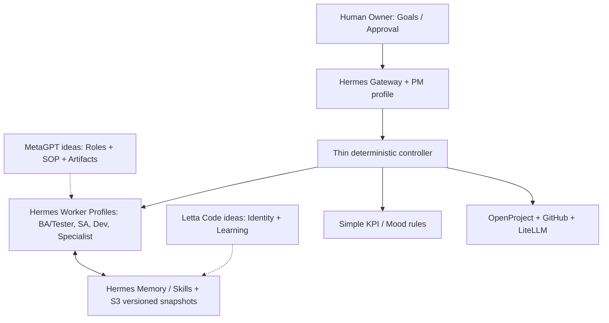

# 06 — Selected reference projects (MVP)

> **Decision: use only two external design references — MetaGPT and Letta Code.** No upstream source code is imported, installed, forked, or integrated in this repository. They are **inspirations**, not runtime dependencies. Hermes is the sole planned agent runtime.

## The two references that matter

| Reference | Take this strength | Implement in Hermes MVP | Explicitly NOT adopting |
|---|---|---|---|
| [MetaGPT](https://github.com/FoundationAgents/MetaGPT) | Software-team roles, SOPs, work products and role handoffs | Five role profiles: **PM → BA/Tester → SA + Tech Specialist → Dev → BA/Tester**, with explicit deliverables, objective QA and human approval; see [Team Design](03-agent-team-design.md) | MetaGPT runtime, generic swarm, uncontrolled agent chat |
| [Letta Code](https://github.com/letta-ai/letta-code) | Persistent identity and long-lived learning from work experience | Hermes-native memory/skills plus role-isolated, versioned S3 snapshots and reviewed reflections; see [Memory/Learning/Mood](04-memory-learning-mood.md) | A second agent runtime, separate Letta server or mandatory memory backend |

## Mood: build a tiny in-house rule, NOT another dependency

Use **validated first-pass acceptance, on-time delivery and weighted utilization**. Show a derived simulated expression (e.g. 🙂 balanced, 😟 needs improvement, 😰 over capacity), supporting numbers, sample size and reason. Small sample => 'insufficient data'. This is operational feedback, **not genuine emotion** and never gives additional privilege. No SoulLink or Emotion Engine runtime/code is required.

## Minimal target composition

- **MVP dependencies:** Hermes, existing LiteLLM/OpenProject/GitHub; AWS ECS Fargate, S3, DynamoDB and CloudWatch.
- **Write only thin glue:** controller (task/state/locks/approval), role profiles, artifact contracts, snapshot wrapper and rule-based KPI/Mood calculator.
- **No extra AI orchestrator:** no MetaGPT, CrewAI or ChatDev execution process.
- **No extra emotion/memory framework:** do not install SoulLink, Emotion Engine or Letta runtime.
- **One project / one feature / one active execution per role** for the first pilot.

## Implementation priorities

1. **P0: MetaGPT-inspired team workflow** on Hermes: 5 roles, SOP, input/output artifacts, GitHub PR + CI, Owner accepts/rejects.
2. **P0: Hermes-native memory survives restart**: role identity, memory and skills restored from isolated approved snapshot; no multi-writer `state.db`.
3. **P1: Letta-inspired improvement loop**: reflect on CI/QA/Owner evidence, propose lesson/skill changes, test and approve before promotion.
4. **P1: Internal KPI/Mood engine**: deterministic simple formulas with evidence, utilization target hypothesis, sample size and trend.

## Usage classification and gates

- **Reference design:** MetaGPT and Letta Code only.
- **Runtime dependency:** Hermes only (pin and verify release before implementation).
- **Our code:** controller, state/locks, snapshots, data contracts and KPI/Mood rules.
- **Future optional imports:** require an ADR with license/version/security checks and measured advantages over native Hermes; not part of MVP.

**Status:** Target design, not deployed or implemented.
