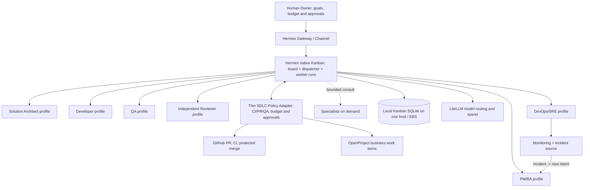
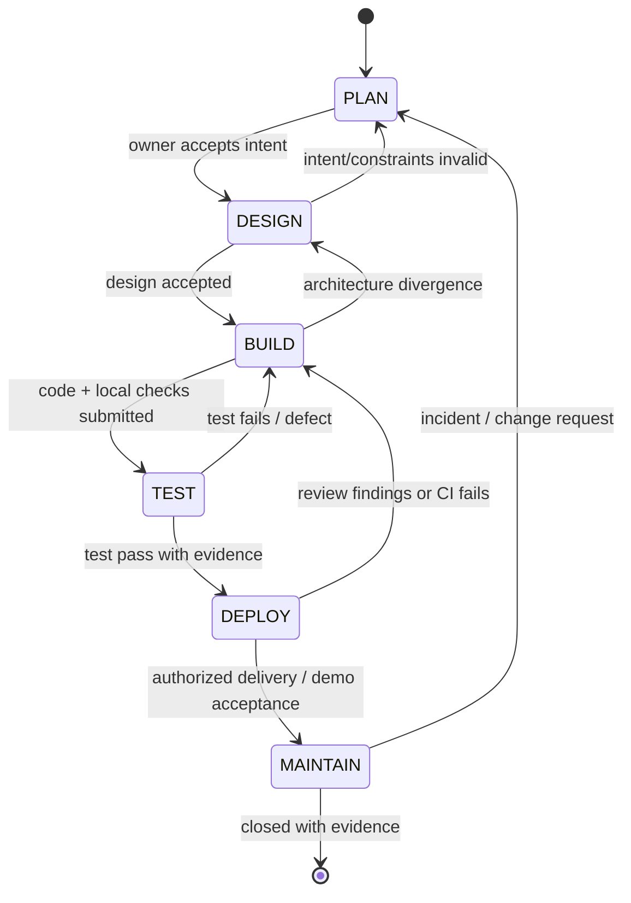

# 08 — Hermes target design: six-stage AI-native SDLC, six core roles

> **STATUS: Proposed target design (not implemented).** This document is the authoritative target for role/process topology as of 2026-11-05. Refer to [the two-day MVP](09-mvp-two-day-execution.md) and [full roadmap](10-full-implementation-roadmap.md) for implementation scope. Earlier five-role layouts in docs 02/03/05/07 are historical baselines, not current role requirements.

## Executive decision

**1 Human Founder/Product Owner + 1 Hermes-native Gateway/Kanban coordination plane + 1 thin deterministic SDLC Policy Adapter + 6 logical core AI roles + on-demand specialist profiles.** There are six SDLC processes, but no need for six servers or always-running models. Hermes Kanban owns local task dispatch and worker lifecycle; the external adapter checks stage acceptance, independent CI/review evidence and named approvals. A chat/orchestrator profile is neither the PM by default nor an independent approval authority.

References: Anthropic, *The AI-Native SDLC Playbook* (2026), stages Plan/Design/Build/Test/Deploy/Maintain; adopt artifact handoffs, feedback, independent checks and human production gates without assuming a Claude-only implementation.



## Skills are procedures, not roles or authority

The five skill patterns studied in [11 — selective vtno/skills adoption](11-vtno-skills-adoption.md) strengthen **how** existing roles execute tasks, without adding roles or changing the six-stage governance contract; Hermes Kanban now owns dispatch and the thin policy adapter owns gates. The adaptation prioritizes one bounded implementation PR, independent two-axis review (**Standards** and **Spec**), caller-defined interfaces and reproducible tests. The task envelope may include `skill_id` and `skill_version` or a Git SHA for evidence; those fields are **not** permissions. The controller, role tool policy, QA evidence and named human approval retain authority. Do not install upstream skills into workers automatically or execute downloaded scripts.

## Four logical boundaries under one orchestrator

Refer to [15 — four logical components and their contracts](15-logical-boundary-architecture.md). Keep **WorkflowController** (policy/SDLC decisions), **DurableExecution** (attempt state/recovery/evidence), **AgentMemory** (approved role/project knowledge), and **SkillManager** (approved reusable procedures) separate as *interfaces*, even if they run on a single Hermes host with local EBS-backed Kanban and optional S3 backup. `AgentWorker` executes bounded tasks using pinned profile, memory, and skill versions. **Execution logs are evidence, not automatically promoted learning.** No new AI roles or mandatory services are added.

## Hermes-native coordination decision

**Current deployment design:** [16 — Hermes-native Gateway/Kanban, profiles and scaling](16-hermes-native-deployment.md). Hermes native **Kanban** is responsible for its **single-host** task board, dependencies, role dispatch, retry and profile lifecycle. The **Thin SDLC Policy Adapter** owns trusted acceptance decisions, external human approval and CI/QA/PR evidence, and only then authorizes downstream cards. It does not implement a duplicate task scheduler. The existing four logical concerns stay separate, but their implementation may be inside one host and shared stores. **A Kanban done/review state is never equal to approval.**

## Role contracts

| Role ID | Mission / accountable deliverable | Inputs | Outputs | Hard boundaries |
|---|---|---|---|---|
| `pm-ba` | Understand Owner goal; prioritize, scope, clarify, write testable business intent | Owner goal, incident/request, constraints | `intent.md`, scope, user stories, acceptance criteria, work-item mapping | No code merge, architecture sign-off or release authority |
| `sa` | Translate approved intent to maintainable design, risks, alternatives, technical plan | Accepted `intent.md`, policies, repo context | `spec.md`, ADR/API/data contract, risk decisions, review of `plan.md` for elevated risk | No self-approval for high-risk architecture or production changes |
| `dev` | Implement the accepted design and reproducible unit checks | Accepted `spec.md`, `plan.md`, repository | Code changes, unit tests, PR, build/test evidence | Cannot approve own PR, bypass tests, push protected branch or deploy production |
| `qa` | Verify observed behavior against acceptance criteria independently of development claims | Locked AC, built artifact, test environment | `test-report.md`, test evidence, defects, regression tests | Cannot weaken AC/tests to make a failing implementation pass |
| `reviewer` | Independent risk/quality/policy review; challenge design-to-diff alignment | `intent.md`, `spec.md`, `plan.md`, PR diff, CI, QA evidence | `review-report.md`: severity-ranked findings and recommendations | AI review **never** equals code-owner approval; cannot both author a fix and be sole verifier of that fix |
| `devops-sre` | Prepare safe releases; run allowed DEV/staging tasks; watch service health | Approved PR, CI/QA/review, deployment runbooks, telemetry | Release plan, deployment evidence, rollback plan, incident/RCA | Production deploy/rollback only through configured authorization; no standing autonomous production privilege |
| `specialist/*` | Consult on a narrow question (security, UX/UI, DBA, cloud, performance, research) | Scoped question and permitted artifacts | A signed-off recommendation and risks | Advisory role, no independent merge/release privileges |

**Founder / Product Owner (human)** owns vision, value, priority, budget/risk appetite, scope acceptance and production release authorization. A human code owner/release manager may be a separately designated person when required by organizational segregation-of-duties policy; Founder approval alone must not circumvent that policy.

## Six process workflow (loop, not waterfall)

| Stage | Lead | Supporting roles | Required handoff artifact | Advance only when |
|---|---|---|---|---|
| `PLAN` | PM/BA | SA if feasibility unclear | `intent.md` + work item/AC | Owner accepts scope, constraint and proposed outcome |
| `DESIGN` | SA | PM/BA; specialist on demand | `spec.md` + risks/ADR | Policy checks pass; Owner or delegated architect signs off per risk tier |
| `BUILD` | Developer | SA | `plan.md`, branch/PR, unit-test evidence | Implementation plan accepted, no forbidden changes; executable build available |
| `TEST` | QA/Tester | Developer fixes only | `test-report.md` + independent verification | Required tests pass against locked AC; failing tests return to Build |
| `DEPLOY` | DevOps/SRE | Independent Reviewer, Developer | `review-report.md`, CI/release/rollback evidence | Independent review + CI meet policy; human approval for protected merge / production |
| `MAINTAIN` | DevOps/SRE | QA, Dev, PM/BA | Incident record, `lessons.md`, new `intent.md` when needed | Monitor and triage; route bugs/improvements to Plan with evidence |

Reviewer is **cross-stage** (design risk review and PR review) even though the strongest mandatory gate is Deploy. Tester is separate from Reviewer. Human judgment remains above the automated loop.

### Allowed transitions and rejection paths



Internal task statuses (`QUEUED, RUNNING, WAITING_APPROVAL, BLOCKED, FAILED, COMPLETED`) are separate from the six stage labels. State transition, access, budget and approval are enforced by deterministic code/external controls; the model may *recommend* a transition but must not authorize itself.

## Artifact and traceability contract

Recommended repo/work-item structure (path is illustrative; customer data and secrets stay in authorized private storage):

```text
workitems/<work_item_id>/
  intent.md
  spec.md
  plan.md
  test-report.md
  review-report.md
  release-record.md
  incident-or-lessons.md
  evidence-manifest.json
roles/
  pm-ba/SOUL.md
  sa/SOUL.md
  dev/SOUL.md
  qa/SOUL.md
  reviewer/SOUL.md
  devops-sre/SOUL.md
  specialist/<name>/SOUL.md
```

Every task envelope minimally contains `project_id, work_item_id, task_id, stage, role_id, input_artifact_refs, acceptance_checks, allowed_tools, policy_version, budget_limit, timeout, attempt`. Every result contains `status, artifact_refs, evidence_refs, test_outcome, changes, risks, spend, model_alias, started_at, ended_at`. Work-item store and Git commit/PR link to each other. Source-of-truth decisions: **OpenProject** for business status/priority, **GitHub** for source and technical artifacts, **immutable private evidence store** for runtime evidence; each record carries stable IDs/commit SHA rather than maintaining divergent editable copies.

## Autonomy and approvals

| Change class | Examples | Agent autonomy | Required authority |
|---|---|---|---|
| L0 — advisory | summarize, risk analysis, documentation proposal | Read, draft, report | Owner accepts changed scope when applicable |
| L1 — reversible development | sandbox branch edits, local tests, dev environment validation | Execute within budgets and sandbox; open PR | Human code owner authorizes protected merge as required |
| L2 — privileged or high impact | auth/IAM, data schema, secrets, spend increase, destructive migration | Prepare plan, evidence and PR; pause before action | Technical/security/change owner approval per policy |
| L3 — production impact | production deploy, rollback affecting customers, destructive production operation | No autonomous bypass; may prepare and request authorization | Named human release/change approver through an enforceable external gate |

Hard controls: scoped IAM and GitHub credentials, protected branches, per-role tool allowlist, secret redaction, isolated working directories, rate/budget/time limits, deny-by-default for write/production tools, immutable audit events. Prompts, `SOUL.md` and skills are **advisory**, not authorization controls. Human reviewer and model-generated Reviewer must be distinguishable in audit logs.

## Deployment split: same design, two implementation depths

- **MVP (two days):** six role profiles, native local Hermes Kanban and single gateway where pinned Hermes is available, deterministic external SDLC acceptance checks, real LiteLLM/PR evidence, explicit manual approvals and DEV/demo only. Existing Python LocalStore scaffold is retained for contract tests but is NOT the preferred production dispatcher. If a real Hermes integration fails, report PARTIAL.
- **Full:** begin with one private EC2/EBS Hermes host, native gateway-owned Kanban and profile workers; external policy checks, GitHub/OpenProject/LiteLLM and evidence backup. Scale vertically, then use independent Hermes hosts for separate workloads; DynamoDB/SQS/ECS are optional later for measured cross-host needs, not the default.

## Memory, learning, behavior and metrics

Keep the prior [memory/mood design](04-memory-learning-mood.md) in **Full** scope: separate role identities, per-project memory, versioned approved knowledge/skills, evidence-based quality, workload-derived *simulated mood* (not literal feelings or permission signals). MVP uses static role instructions and a simple `lessons.md` or run log only. Do not enable auto skill promotion during the two-day timebox.

Metrics: end-to-end lead time; first-pass CI and QA pass rate; rework/escaped defects; time to PR review; approval wait; cost per accepted task (including retries and fixed allocation), policy violations; incident recurrence. Report “insufficient data” on tiny samples.

## Design constraints and non-goals

- Preserve portability seams (`ModelGateway`, `TaskRunner`, `WorkItemStore`, `ArtifactMemoryStore`); do not build four microservices.
- 1 agent role is a **contract/profile**; multiple profiles can reuse the same model and worker implementation.
- For two days, choose **working thin vertical slice over production-like infrastructure**. If a dependency blocks, use a documented mock adapter and mark the integration NOT COMPLETE.
- "Full" means target capabilities must be delivered and verified in later milestones; this document is not evidence that implementation already exists.
