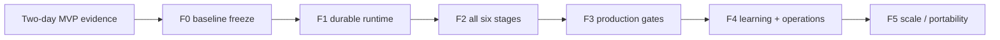

# 10 — Full implementation roadmap (complete target design)

> **Phase: FULL / no two-day limit.** Follows [target roles and workflow](08-six-stage-role-target.md) and starts from an evidence-backed [two-day MVP](09-mvp-two-day-execution.md). This is a **delivery plan, not proof that infrastructure or software exists**. Full scope covers the original Hermes/AWS/memory/mood design plus six-role review separation and the AI-native six-stage loop.

## Skills adoption decision

Use [11 — selective vtno/skills integration](11-vtno-skills-adoption.md) as the procedure layer for existing roles, not as a new platform. F0 freezes reviewed skill schema/provenance; F2 adds two-axis Standards/Spec review and bounded author–review loops; F3 enforces tool allowlists, source/license verification, immutability and approval outside Skills; F4 adds regression evals, skill promotion/rollback and measured selection quality. Reviewer findings remain advisory until deterministic gates and named human code-owner controls take effect. Keep all upstream skill/script fetches out of production task execution.

## Decision: separate durable execution from learned knowledge

[15 — logical component architecture](15-logical-boundary-architecture.md) is the authoritative boundary map. **WorkflowController** decides workflow and policy; **DurableExecution** retains task/attempt state, checkpoints and evidence; **AgentMemory** retains approved role/project knowledge; **SkillManager** resolves approved procedures and promotes versions only after review. AgentWorkers remain disposable. These are *logical* boundaries; DynamoDB/S3/Git can be shared with scoped data ownership, permissions and retention.

**Release plan:** F0 freezes contracts; **F1** implements crash-safe DurableExecution; **F2** consumes pinned memory/skill snapshots while executing six stages; **F3** provides authenticated approval and isolation; **F4** adds controlled AgentMemory/SkillManager learning, evaluation, promotion and rollback. Running tasks never receive a silently changed knowledge/skill version. No change to 2-day MVP or six AI roles.

## Default runtime now Hermes-native (2026-11-11)

[16 — Hermes-native Kanban + single-host deployment](16-hermes-native-deployment.md) is the **current implementation target**. Prefer native Hermes Gateway, profile management, Kanban task dependency/dispatch and local run recovery. Keep one **thin external SDLC Policy Adapter**, not another multi-agent scheduler. The first AWS pilot uses **private EC2 + EBS + systemd gateway**, with S3 backup/evidence and existing LiteLLM/GitHub/Plane. **ECS Fargate + DynamoDB distributed worker designs below are historical alternatives**, not mandatory platform components. Scale up one host first; add **independent** Hermes hosts by project later (no shared live Kanban SQLite across hosts).

## Integration direction: Plane business + Telegram human channel

[17 — Plane + Telegram integration](17-plane-telegram-integration.md) is authoritative for **business work management and chat**. Plane is the single authoritative work tracker, replacing Plane as a default. The native Hermes Telegram adapter is the preferred Owner entrypoint/notification channel with allowlisted sender IDs and a single bot token owned by one ingress profile. The **Thin Plane–Hermes Bridge + SDLC Policy Adapter** owns workspace/project authorization, event idempotency, work-item/task mapping, and QA/CI/real human approval gates — not native worker dispatch.

**F1** validates Telegram outbound long polling on private EC2 and safe status read. **F2** implements Plane work-item integration (prefer API reconciliation/polling for pilot private host, or signed v2 webhook when approved ingress exists) and evidence sync; **F3** enforces enterprise identity binding and privileged approval. A message/emoji from Telegram is not an enterprise approval. Preserve the existing six-stage pipeline, six roles, and cost limits.

## Full end state

- One Human Founder/Product Owner controls goal, prioritization, budget, exceptions and final production decisions.
- One deterministic orchestration/control layer coordinates **6 core AI roles** (`pm-ba, sa, dev, qa, reviewer, devops-sre`) plus specialist pool only when needed.
- All **Plan, Design, Build, Test, Deploy, Maintain** stages have versioned artifacts, repeatable checks, explicit human/policy gates and reject/rework transitions.
- Runtime follows [16](16-hermes-native-deployment.md): one EC2 + EBS Hermes gateway hosting native Kanban and six profiles, local SQLite protected by consistent backups, external SDLC policy/approval gates, and existing LiteLLM + GitHub + Plane + CloudWatch. S3 stores approved backups/evidence, not a live shared SQLite database. Only later introduce more hosts by project shard when justified.
- Role-specific persistent identity, project-scoped memory, approved learning/skills, objective performance signals and transparent **simulated mood** implemented as described in [memory design](04-memory-learning-mood.md).
- Enforce security boundaries outside prompts; Reviewer cannot make its own approval binding; independent human code/release authority remains in force.

## Delivery order / implementation waves

No fixed Full deadline is asserted. Estimate effort and staffing after the two-day spike; each wave is independently demonstrated before moving to the next.

| Wave | Focus | Key deliverables | Acceptance gate |
|---|---|---|---|
| F0 — baseline freeze | Stabilize MVP | Versioned schemas; golden demo; role/policy registry; real connector gap list; CI unit tests | Demo reproducible on clean machine; no fictitious results |
| F1 — Hermes-native operations | Runtime/hosting | Private EC2 + EBS, one Hermes gateway-embedded Kanban dispatcher, role profiles, monitored restarts, application-consistent SQLite backups, S3 evidence, IAM/Secrets/SSM/CloudWatch | One host restores correctly; retry reconciles GitHub side effects; no self-approval or duplicate protected action |
| F2 — full six-stage execution | Product workflow | Plane work-item sync; approved `intent/spec/plan`; branch/PR integration; QA pipeline; independent Reviewer policy, release preparation and rollback runbooks; incidents -> Plan | One real sample story passes all six stages and all return paths with linked audit |
| F3 — production governance | Risk/security and release | Branch protection, least privilege, network/egress policy, model/MCP allowlists, approvals outside prompts, per-env autonomy tiers, supply-chain/secret scanning, policy-as-code | Blocked unauthorized tool, self-merge, over-budget and production deployments proven in automated negative tests |
| F4 — reliability, memory & learning | Continuous improvement | Stable role/project memory, versioned snapshot promotion, approval-gated skills, regression eval suite, feedback ingestion from QA/review/incidents, metrics + cost attribution, workload/mood display | Lessons survive worker restart; policy/skill change can be reverted; mood never alters authority |
| F5 — hardening & scale | Operational excellence and portability | Autoscaling/queue **only if measured bottleneck**; multi-project isolation; load tests; chaos tests; dashboards where valuable; alternate runner/model/work-item adapters and export tests | SLOs and recovery proven with bounded cost; no tenant data leak; adapter contract tests pass |

### Gate dependency sequence

F3 controls that are prerequisites for a particular deployment **must ship before** that deployment, even if the F2 workflow can demo in DEV earlier. F5 scalability is demand-triggered; do not install SQS, Step Functions, K8s, vector/graph DB or a bespoke UI just to satisfy an architecture diagram.

## Full component design

| Boundary | Selected implementation | Owned capability | Scaling/portability note |
|---|---|---|---|
| Owner entrypoint | Existing Hermes channel/Gateway (may be Telegram or UI) | Request intake, status, explicit approvals | Swap channel without changing workflow |
| Coordination and workflow | Native Hermes Gateway + Kanban **plus thin SDLC policy adapter** | Native tasks, dependencies, role dispatch, retries; trusted external gates for scope/CI/QA/PR/human approval | One dispatcher, no duplicate controller; cards alone do not authorize transitions |
| Worker runtime | Native Hermes local per-profile managed workers on EC2 | Role-scoped tasks, Skills, Memory, bounded tools | Scale concurrency inside one host; profile != security sandbox |
| Task/state | Hermes Kanban SQLite on local encrypted EBS | Boards, task/run attempts, dependencies, local claim and retry evidence | Application-consistent backup/restore; single-host only |
| Artifacts vs approved memory | Local Hermes home/workspace + scoped S3 backup/evidence; Git as source for approved Skills | Keep task results separate from approved learning and profiles | No automatic memory/skill promotion; project isolation enforced externally |
| Model gateway | Existing LiteLLM | Model alias mapping, separate role keys, spend/limits, routing | Model-agnostic role definitions; no model name in role prompts |
| SCM and CI | GitHub + existing CI | PRs, checks, merge protection, code owner | Dev agent cannot merge itself |
| Work management | Existing Plane | Priorities, stories, acceptance, operational status | Single authoritative business work item |
| Observability | CloudWatch structured logs + optional additional monitoring connector | Stage latency, trace, incident trigger, cost, alert | Deterministic detectors initiate a bounded agent response |
| Deployment | CI/CD runbooks surfaced as narrowly scoped tools | DEV/staging deploy, production preflight, rollback | Production gate enforced by platform, not prompt |
| Specialist pool | On-demand scoped profiles | Security, cloud, DBA, UX, performance | Spawn only when complex question exists |

## Detailed functional backlog

### F1 — core reliability
- [ ] Pin and verify Hermes version, noninteractive CLI behavior, tool/MCP semantics, memory approval behavior and LiteLLM protocol compatibility.
- [ ] Pin Hermes version and six profile definitions; verify gateway multiplex and native worker spawn on one EC2 host; never run multiple processes writing the same Hermes profile/board.
- [ ] Use native Kanban dependency/dispatch/retry instead of duplicating a task scheduler; implement external SDLC gate checks for accepted Plan/Design, real QA/CI, review blockers and named human decisions.
- [ ] Configure one gateway-owned dispatcher, explicit multi-profile/board ownership, worker limits and quotas; prove local process lifecycle with systemd and gateway restart.
- [ ] Use local encrypted EBS for active SQLite/profile state; test SQLite-consistent backups and restore from an isolated host; S3 for private approved evidence/profile snapshots, not a live DB mount.
- [ ] Alarm on gateway/worker crash, blocked cards, disk pressure, missing backup, credential expiry, LiteLLM budget and failed restore; reconcile duplicate external PR/CI effects.

### F2 — team operating system
- [ ] Six `SOUL.md` role definitions; tool/permission matrix and per-role spend caps; optional specialist registry.
- [ ] Plan: Plane issue + `intent.md` + Owner scope acceptance.
- [ ] Design: `spec.md`, ADR and flagged conflicts with security/UX standards, risk-based SA/Owner decision.
- [ ] Build: `plan.md` first, controlled code generation on sandbox branch, local tests, change vs plan check.
- [ ] Test: independent QA validation against immutable AC, red-to-green bug reproduction, CI evidence; defect back to Build.
- [ ] Deploy: multi-pass Independent Reviewer, deterministic code/secret/policy checks, named code-owner gate, CI deployment to DEV/staging, human production authorization and rehearsed rollback.
- [ ] Maintain: event/incident intake, deterministic alert bands, bounded diagnosis, `incident` and new `intent.md`, triage/route to Plan.
- [ ] Every artifact records work item, version, actor identity, approval decision, model alias, timestamp and evidence pointer.

### F3 — security, governance and financial control
- [ ] Separate controller/worker/admin IAM and secrets; OIDC or short-lived scoped credentials where possible.
- [ ] IAM/MCP policy guardrails per stage and role; explicit deny for self-approval, permission escalation, protected paths and production operations.
- [ ] Prompt-injection-resistant trust ordering: approved policy/owner decisions supersede external tool, repo and web content.
- [ ] Protection for regulated/high-impact changes (auth, IAM, PII, DB migrations, payment/data deletion), with named approvers.
- [ ] Model and tool routing budget limits, retry caps, maximum runtime, exportable trace and cost by accepted work item. Reconcile LiteLLM spend and AWS fixed/variable costs.
- [ ] Data classification, PII scrubbing, retention, backup and restore, authorized cross-project access policy.

### F4 — memory, evals, behavior and operations
- [ ] Implement separate identity/working/project/personal/procedural memory layers; snapshot promotion with lock/CAS and rollback.
- [ ] Generate proposed lessons after completed tasks; compare against objective QA/CI/Owner evidence; require review + eval before skill promotion.
- [ ] Golden regression/eval cases from real errors; rerun for changes to prompts, skills, model aliases, reviewers and guardrails.
- [ ] Implement workload, first-pass acceptance, cost per accepted story, approval wait, change failure, MTTR and recurring-incident views.
- [ ] Derive *simulated mood* from verifiable workload/quality; insufficient-data handling/hysteresis; no impact on policy, privileges, release or budget.
- [ ] Incident -> diagnosis -> reviewed PR/new intent -> tested fix -> new eval. Prevent unbounded self-trigger loops with deduplication and human escalation.

### F5 — scale & vendor flexibility
- [ ] Multi-project namespaces, quotas and project isolation tests; tune concurrency only as review throughput permits.
- [ ] First tune native Kanban concurrency and EC2 resources; introduce independent Hermes project hosts, central intake/router or external queue **only** after measuring bottlenecks.
- [ ] Canary/rollback, rate limiting, performance/load exercises, disaster-recovery drill and cost/quality SLOs.
- [ ] Contract tests for `ModelGateway, TaskRunner, WorkItemStore, ArtifactMemoryStore` with export/import to a non-AWS or non-Hermes backend.
- [ ] Future UI only when chat/Markdown reporting demonstrably insufficient; no separate emotion engine.

## Ownership / approval matrix

| Gate | Responsible to prepare | Mandatory independent evidence | Approval authority |
|---|---|---|---|
| Scope | PM/BA | `intent.md`, AC, budget | Human Owner |
| High-risk design | SA | ADR, policy risk; specialist consult | Delegated architect/security owner + Owner if impact requires |
| Code implementation | Dev | Test and CI result | No self-approval |
| QA acceptance | QA | AC-linked functional/regression evidence | QA decision recorded; code owner checks required evidence |
| PR/release readiness | Reviewer + DevOps/SRE | Independent review, QA, CI, security and rollback notes | Human code owner / release approver according to policy |
| Production change | DevOps/SRE | Signed change authorization + deploy/rollback | Named human production authority |
| Skill/policy promotion | Role proposer + reviewer | Golden evals and change diff | Policy owner / human authorized approver |

## Exit criteria for FULL completion

- [ ] End-to-end Plan → Maintain closes the loop for real work items with linked Plane/GitHub/S3 and audit records.
- [ ] All six roles execute under distinct identity/tool policy; Reviewer independence and human approvals are enforced outside LLM.
- [ ] System safely survives worker loss, Gateway restart, lease expiry, repeated event, model timeout and rollback attempt without duplicate unsafe action.
- [ ] Agent never writes protected main, bypasses a release gate, reads disallowed project secrets or executes unapproved production action.
- [ ] Independent CI/evals catch regression; fake, stale or missing evidence cannot mark a stage passed.
- [ ] Memory/skills are reproducible and reversible; learning happens only after evaluation and approval.
- [ ] Cost by role/task/model and cost per accepted item include retries and proportional infrastructure, with alerts and budgets.
- [ ] Mood is explicitly simulated, explainable and cannot modify security decisions.
- [ ] Operations manual includes incident/restore/rotate/revoke/kill-switch and well-tested rollback.
- [ ] Controlled multi-project concurrency and provider/tool swap pass contract/isolation tests, if enabled.

## Source of truth and related documents

- **Authoritative new design:** [08 target](08-six-stage-role-target.md), [09 two-day MVP](09-mvp-two-day-execution.md), **this Full roadmap**.
- **Reusable original detail:** [01 alternatives](01-architecture-options.md), [02 AWS architecture](02-target-architecture.md), [04 memory/learning/mood](04-memory-learning-mood.md), [06 adoption references](06-reference-project-adoption.md), [07 operational guardrails](07-operational-guardrails.md).
- Original five-role and multi-sprint MVP assumptions in 02/03/05/07 remain only as **historical background** where conflicting; new role and timebox decisions supersede them.
